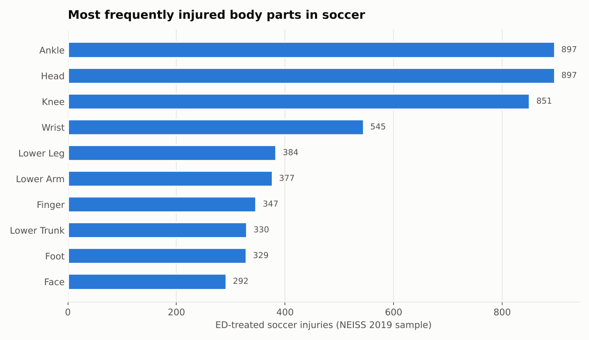
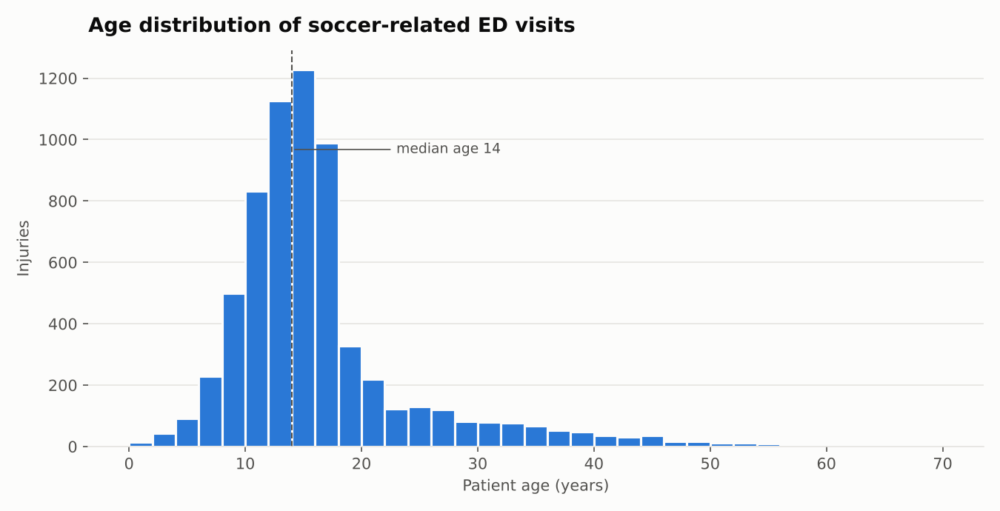
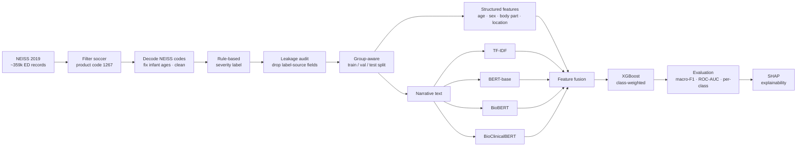

<div align="center">

# 🩺 Multimodal Injury Severity Classification from Emergency-Department Narratives

### Combining clinical free-text with structured patient data to classify sports-injury severity, comparing TF-IDF against BERT, BioBERT and BioClinicalBERT, with SHAP explanations


</div>

> [!NOTE]
> This was built as a **client project**, so the source code, processed data and trained models stay private. This repository only describes the approach and what I learned. The underlying dataset is public (see [Dataset](#-dataset)).

---

## 📌 Table of Contents
- [Overview](#-overview)
- [Highlights](#-highlights)
- [Dataset](#-dataset)
- [Pipeline](#-pipeline)
- [Severity Labelling](#-severity-labelling)
- [Text Representations](#-text-representations)
- [Modelling](#-modelling)
- [Results Summary](#-results-summary)
- [Explainability](#-explainability)
- [Tech Stack](#-tech-stack)
- [Key Learnings](#-key-learnings)
- [Limitations](#-limitations)

---

## 🔭 Overview

Hospital emergency departments record every injury twice: once as **structured codes** (age, sex, body part, location) and once as a short **free-text narrative** written by staff, such as *"14 YOM twisted ankle playing soccer, DX ankle sprain"*.

This project asks:

1. Can a model **classify injury severity (Minor / Moderate / Severe)** from these records?
2. Which **text representation** works best for short clinical narratives: classic **TF-IDF**, or pretrained transformers (**BERT-base, BioBERT, BioClinicalBERT**)?
3. **Which words and features drive the predictions?** This is answered with SHAP.

The case study uses **soccer-related injuries** from the U.S. NEISS emergency-department surveillance data.

---

## ✨ Highlights

- 📥 Extracted **~6.6k soccer injury cases** from **~359k** national ED records using official NEISS product codes.
- 🧹 Decoded the numeric NEISS codes into readable labels and fixed NEISS's **infant age encoding** (e.g. `206` means 6 months).
- 🏷️ Built a **rule-based 3-class severity target** and removed the variables used to build it from the predictors, to avoid target leakage.
- 🔒 Used a **leakage-safe group split**, so identical narratives can never appear in both training and test.
- 🤖 Compared **4 text representations**, each fused with structured features and classified with **XGBoost**.
- 🏆 **TF-IDF + structured features beat all three BERT variants**: about **95 % accuracy** and **0.70 macro-F1** on the held-out test set.
- 🔍 Used **SHAP** to explain which narrative terms and patient attributes drive each severity class.

---

## 🗂️ Dataset

### Source: NEISS (National Electronic Injury Surveillance System), U.S. Consumer Product Safety Commission

| Resource | Link |
|---|---|
| 🌐 NEISS home & data access | https://www.cpsc.gov/Research--Statistics/NEISS-Injury-Data |
| 🔎 NEISS Estimates Query Builder | https://www.cpsc.gov/cgibin/NEISSQuery/UserCriteria.aspx |
| 📘 NEISS Coding Manual (2019) | https://www.cpsc.gov/s3fs-public/2019-NEISS-Codng-Manual.pdf |
| 📊 2019 NEISS Data Highlights | https://www.cpsc.gov/s3fs-public/2019-NEISS-data-highlights.pdf |

NEISS collects data on consumer-product-related injuries treated in U.S. emergency departments and is used to produce national injury estimates. The **2019 data comes from a probability sample of 96 hospitals**. Each record includes coded fields and a **free-text narrative** describing the incident.

### What was used

| Property | Value |
|---|---|
| File | Annual NEISS dataset, **treatment year 2019** (`neiss2019`) |
| Raw records | ~358,700 ED cases (all products) |
| Filter | **Product code 1267 = Soccer (activity, apparel or equipment)**, matched in any of `Product_1`, `Product_2` or `Product_3` |
| Soccer cases | **6,591** |
| Missing values after cleaning | 0 |

### Key fields

| Field | Description | Used as |
|---|---|---|
| `Narrative_1` | Free-text description of the incident and diagnosis | **Text input** |
| `Age` | Age in years (values `2xx` = infant age in months) | Structured feature |
| `Sex`, `Hispanic` | Demographics | Structured features |
| `Body_Part` | Coded injured body part | Structured feature |
| `Location` | Where the injury happened (school, sports venue, home…) | Structured feature |
| `Diagnosis` | Coded diagnosis | Used to build the label, **not** used as a feature |
| `Disposition` | Treated and released, admitted, transferred, fatality… | Used to build the label, **not** used as a feature |
| `Weight` | Statistical sampling weight | Not used for modelling |

### A look at the public data

<p align="center">
  
  
</p>

Soccer ED visits are **dominated by young players** (median age 14, with roughly three-quarters under 18). **Ankle, head and knee** are the most commonly injured body parts.

**How to get the same data:** go to the [NEISS data page](https://www.cpsc.gov/Research--Statistics/NEISS-Injury-Data), download the archived **2019** annual dataset, and filter rows where any product column equals **1267**. Use the coding manual to decode body part, diagnosis, disposition and location.

---

## 🔬 Pipeline



---

## 🏷️ Severity Labelling

NEISS has no severity column, so a **transparent rule-based target** was built from disposition and diagnosis:

| Class | Rule | Share |
|---|---|---:|
| 🔴 **Severe** | Patient was **admitted, transferred or died** | ~3 % |
| 🟠 **Moderate** | Diagnosis is a **fracture, dislocation, concussion, internal organ injury or nerve damage** | ~36 % |
| 🟢 **Minor** | Everything else (sprains, contusions, strains…) | ~61 % |

**Leakage controls:**
- `Disposition` defines the Severe class, so it is **excluded** from the predictors.
- `Diagnosis` defines the Moderate class, so it is **excluded** from the structured predictors and kept for description only.
- The heavy **class imbalance** (Severe at about 3 %) is handled with **balanced class weights** (Severe is weighted about 12×).

---

## 🧠 Text Representations

| Representation | How it works | Dimensionality |
|---|---|---:|
| **TF-IDF** | Unigrams and bigrams, sublinear TF, fit on training text only | ~6.9k sparse |
| **BERT-base** (`bert-base-uncased`) | Frozen encoder, mean-pooled last hidden state | 768 |
| **BioBERT** (`dmis-lab/biobert-base-cased-v1.1`) | Biomedical-domain BERT, frozen, mean-pooled | 768 |
| **BioClinicalBERT** (`emilyalsentzer/Bio_ClinicalBERT`) | BERT further trained on clinical notes, frozen, mean-pooled | 768 |

- I checked the narrative lengths first: they are short (about 26 tokens on average, all under 128), so **`max_length = 128` meant no text was truncated**.
- The transformers are used as **frozen feature extractors** rather than being fine-tuned, so all four representations are compared on equal terms with the same classifier.

Each representation is **concatenated with the 37 encoded structured features** (standardised age plus one-hot categoricals) before classification.

---

## 🤖 Modelling

**Classifier:** XGBoost multiclass (`multi:softprob`) with the same configuration for every representation, so the comparison isolates the effect of the text representation:

```
n_estimators=300 · max_depth=5 · learning_rate=0.05
subsample=0.8 · colsample_bytree=0.8 · tree_method="hist"
sample weights = balanced class weights
```

**Leakage-safe split:** I found **12 groups of identical narratives** and checked whether they crossed splits. Several did, so I replaced the random split with a **`StratifiedGroupKFold`-based split** that keeps every identical narrative inside a single split while preserving the class balance:

| Split | Cases | Minor / Moderate / Severe |
|---|---:|---|
| Train | ~4.6k | 61 / 36 / 3 % |
| Validation | ~1.0k | 61 / 36 / 3 % |
| Test | ~1.0k | 61 / 36 / 3 % |

**Metrics:** macro-F1 is the main metric because of the class imbalance. Accuracy, macro precision, recall and specificity, ROC-AUC (one-vs-rest), PR-AUC and per-class scores are also reported.

---

## 📊 Results Summary

Held-out test set, ranked by macro-F1 (rounded):

| Rank | Representation + Structured | Accuracy | Macro-F1 | ROC-AUC |
|:---:|---|---:|---:|---:|
| 🥇 | **TF-IDF** | **~95 %** | **~0.70** | ~0.92 |
| 🥈 | BioClinicalBERT | ~92 % | ~0.64 | ~0.91 |
| 🥉 | BioBERT | ~90 % | ~0.63 | ~0.90 |
| 4 | BERT-base | ~90 % | ~0.60 | ~0.91 |

**What this means:**
- **Simple beat complex.** On short, abbreviation-heavy notes (`YOM`, `DX`, `FX`), TF-IDF directly captures the decisive keywords. Frozen, mean-pooled transformer embeddings dilute them.
- **Domain pretraining helps among the transformers.** BioClinicalBERT > BioBERT > general BERT, which matches how clinical their training text is.
- **With the best model, Minor and Moderate are classified very well** (F1 above 0.9). **Severe remains hard**: with only about 27 test cases and few textual cues, recall stayed low for every representation. This is the main open problem.

---

## 🔍 Explainability

SHAP (`TreeExplainer`) was applied to the best model to explain predictions **globally and per class**:

| Class | Most influential signals |
|---|---|
| **Minor** | Words like *"sprain"*, *"contusion"*, *"strain"* and *"pain"* push towards Minor. *"fx"* and *"fracture"* push away |
| **Moderate** | *"fx"*, *"fracture"*, *"dislocation"*, *"concussion"* and **head** as the body part |
| **Severe** | Patient **age**, lower-limb terms (*"ankle"*, *"knee"*) and contextual words |

The explanations are **clinically sensible**: the model relies on the injury terms a clinician would look for, not on artefacts.

---

## 🛠️ Tech Stack

| Area | Tools |
|---|---|
| Language | Python 3.12 |
| Data | pandas, NumPy, SciPy (sparse matrices) |
| Classic ML | scikit-learn (`ColumnTransformer`, `TfidfVectorizer`, `StratifiedGroupKFold`), XGBoost |
| Deep learning / NLP | PyTorch, Hugging Face Transformers |
| Explainability | SHAP |
| Visualisation | Matplotlib, Seaborn |

---

## 💡 Key Learnings

- **Audit for leakage at every level:** columns (the fields used to build the label), rows (duplicate narratives across splits) and preprocessing (vectorisers and scalers fit on training data only).
- **Benchmark the simple baseline.** TF-IDF beat 110M-parameter transformers here. The best representation depends on the data, not on the model's size.
- **Text can carry the label.** NEISS narratives often state the diagnosis (`DX FX`), which overlaps with how the Moderate class was defined. Much of the strong Minor/Moderate performance comes from this, and spotting it matters when interpreting results.
- **Accuracy hides minority-class failure.** About 95 % accuracy sat alongside weak Severe recall. Per-class metrics and macro-F1 told the real story.
- **Explainability builds trust.** SHAP confirmed the model's reasoning is clinically plausible and made the Moderate-class keyword effect visible.

---

## ⚠️ Limitations

- Severity is a **rule-based proxy**, not a clinician-assigned score.
- The **Severe class is very small** (about 3 %), so its estimates are unstable and recall is low.
- Transformers were **not fine-tuned**. Fine-tuning, or oversampling and threshold tuning for Severe, are natural next steps.
- NEISS is a **U.S. hospital sample** and sampling weights were not used in modelling, so results describe the sample rather than national rates.

---

## 🙏 Data Acknowledgement

Injury data: **U.S. Consumer Product Safety Commission, National Electronic Injury Surveillance System (NEISS), 2019**.

---

<div align="center">

**🔒 Source code is private (client project). Happy to walk through the approach in an interview.**

</div>
